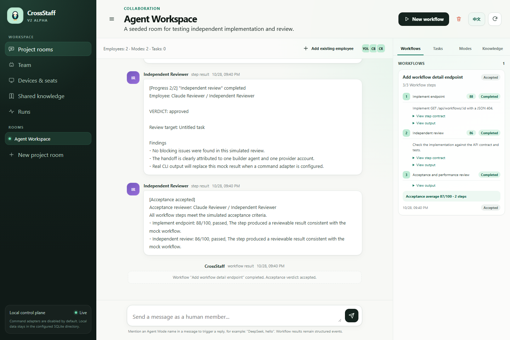
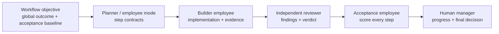

<p align="center">
  <picture>
    <source media="(prefers-color-scheme: dark)" srcset="docs/assets/crossstaff-banner-dark.svg">
    
  </picture>
</p>

<h1 align="center">A local-first workspace for digital employees</h1>

<p align="center">
  <strong>Manage AI agents like real employees.</strong>
</p>

<p align="center">
  <a href="docs/PLATFORMS.md"></a>
  <a href="https://nodejs.org/"></a>
  <a href="https://www.sqlite.org/"></a>
  <a href="docs/ARCHITECTURE.md"></a>
  
  <a href="LICENSE"></a>
  
</p>

<p align="center">
  <a href="README.md">English</a> ·
  <a href="README.zh-CN.md">简体中文</a> ·
  <a href="docs/QUICKSTART.md">Quick start</a> ·
  <a href="docs/API.md">API</a> ·
  <a href="docs/API-PROVIDERS.md">Providers</a> ·
  <a href="docs/ARCHITECTURE.md">Architecture</a> ·
  <a href="docs/BRAND.md">Brand</a>
</p>

CrossStaff turns a collection of AI agents into a manageable digital workforce. Every employee has a stable identity, one active organization/API/CLI seat, private memory, role-specific modes, and an auditable history. Rooms provide shared project knowledge and human-visible collaboration. DAG workflows move work between employees, while a separate acceptance employee evaluates every step.

CrossStaff is not another single-agent chat window. It is the operating layer around the work: who owns it, which account is running, what context passed forward, who reviewed it independently, and how the result was accepted.

<p align="center">
  
</p>

## Why CrossStaff

Most agent products optimize one prompt or one run. Real work has organizational questions:

- Which employee and account are responsible?
- What private memory and shared facts were available?
- Which work can run in parallel, and what must wait?
- What exactly is this step required to deliver?
- Did an independent employee review it?
- What evidence supports the final acceptance score?

CrossStaff makes those boundaries visible before execution and preserves them afterward.

| Without CrossStaff | With CrossStaff |
| --- | --- |
| Copy context between terminals | Shared room knowledge plus private employee memory |
| One agent reviews itself | Independent review across different employees |
| Optimize a single prompt | Assign local step contracts inside a DAG |
| Remember account usage manually | One active seat per digital employee |
| Results disappear into chat history | Auditable runs, verdicts, scores, and evidence |
| Provider-specific orchestration | Codex, Claude Code, Kimi Code, and OpenAI-compatible APIs together |

## One workflow, visible end to end



Each work step stores its own:

- **Objective** — the local outcome this employee must produce.
- **Required inputs** — prerequisites, files, environment, or confirmations.
- **Deliverables** — inspectable artifacts such as code, tests, findings, or a verdict.
- **Forbidden actions** — scope boundaries and operations that must not happen.
- **Completion criteria** — how the step and its acceptance reviewer decide it is done.

The workflow objective remains the higher-level contract. A step narrows responsibility; it cannot silently remove a global requirement. Direct dependencies pass their objectives, expected deliverables, and actual outputs downstream.

## What is included

| Area | Capabilities |
| --- | --- |
| **Digital employees** | Roster, manager relationships, offboarding, guarded deletion, employee memory, performance history |
| **Seats and identities** | Exactly one active organization seat, API identity, or official CLI account per employee |
| **Agent modes** | Multiple role behaviors per employee without creating extra headcount |
| **Rooms** | Reuse employees across projects, share knowledge, visible room messages, active-work-safe deletion |
| **Workflows** | Parallel roots, dependency joins, step contracts, failure isolation, cancellation, live progress |
| **Acceptance** | Automatic final reviewer, per-step scores, evidence, and employee performance aggregation |
| **Adapters** | Local command, OpenAI-compatible HTTP API, and dependency-free mock mode |
| **Platforms** | Direct Node.js on Windows, macOS, and Linux; Docker for UI and API/Mock adapters |
| **Interface** | Chinese and English, first-run setup wizard, live SSE updates |

## Quick start

**Requires Node.js 24+.** There are no third-party runtime dependencies.

```bash
git clone <repository-url>
cd <repository-directory>
npm start
```

Open <http://localhost:8787> and complete the setup wizard.

To use a local CLI such as Codex or Claude Code:

```bash
CROSSSTAFF_ALLOW_COMMANDS=1 npm start
```

Windows PowerShell:

```powershell
$env:CROSSSTAFF_ALLOW_COMMANDS = "1"
npm start
```

The detailed Quick Start uses a real model and is designed to complete a first workflow without Mock:

- [English Quick Start](docs/QUICKSTART.md)
- [中文快速开始](docs/QUICKSTART.zh-CN.md)

## Connect real agents

### OpenAI official API

Add the key to `.env` or the CrossStaff process environment. The AgentMode stores only the environment-variable name.

```dotenv
OPENAI_API_KEY=your-openai-api-key
```

```json
{
  "type": "api",
  "provider": "openai",
  "baseUrl": "https://api.openai.com/v1",
  "model": "gpt-6.1-sol",
  "apiKeyEnv": "OPENAI_API_KEY",
  "timeoutMs": 180000
}
```

OpenAI recommends Responses for new projects. CrossStaff currently uses Chat Completions for cross-provider compatibility; confirm model access in the [official API model catalog](https://developers.openai.com/api/docs/models).

### DeepSeek

```dotenv
DEEPSEEK_API_KEY=your-deepseek-api-key
```

```json
{
  "type": "api",
  "provider": "deepseek",
  "baseUrl": "https://api.deepseek.com",
  "model": "deepseek-flash",
  "apiKeyEnv": "DEEPSEEK_API_KEY",
  "timeoutMs": 180000
}
```

### Kimi / Moonshot and other compatible APIs

```dotenv
MOONSHOT_API_KEY=your-moonshot-api-key
```

```json
{
  "type": "api",
  "provider": "openai-compatible",
  "baseUrl": "https://api.moonshot.cn/v1",
  "model": "your-kimi-model",
  "apiKeyEnv": "MOONSHOT_API_KEY",
  "timeoutMs": 300000
}
```

The same adapter works with any service exposing Bearer-authenticated `POST /chat/completions` and returning `choices[0].message.content`:

| Provider | Base URL | Example model |
| --- | --- | --- |
| OpenRouter | `https://openrouter.ai/api/v1` | Exact `provider/model-id` |
| Ollama | `http://127.0.0.1:11434/v1` | Exact name from `ollama list` |
| Other compatible services | Provider base URL | Provider model ID |

Use `OLLAMA_API_KEY=ollama` as a non-empty local placeholder because the current API adapter requires a key variable.

### Native non-OpenAI protocols

The direct API Adapter does **not** currently support Anthropic Messages, Gemini `generateContent`, or Azure OpenAI deployment/header overrides. Use a trusted local Command Adapter bridge or an OpenAI-compatible gateway. The guide includes a minimal Anthropic bridge example and the exact protocol differences:

→ **[API Provider Guide](docs/API-PROVIDERS.md)**

### Codex CLI

Use an isolated Codex profile so the desktop app and CrossStaff do not overwrite each other:

```bash
# macOS / Linux
./scripts/login-codex-cli.sh
```

```powershell
# Windows
.\scripts\login-codex-cli.ps1
```

### Claude Code and Kimi Code

Command Adapters send the complete prompt through stdin, capture stdout, enforce a timeout, and never interpolate the prompt into a shell command. See [Adapter examples](docs/ADAPTERS.md).

## Core concepts

| Concept | Responsibility |
| --- | --- |
| **Employee** | Stable identity, title, manager, memory, performance, and history |
| **SeatBinding** | One active account/API/CLI authorization owned by an employee |
| **AgentMode** | A role-specific behavior under one employee |
| **Room** | A project team sharing messages, modes, workflow context, and knowledge |
| **Workflow Step** | A local objective plus inputs, deliverables, forbidden actions, and completion criteria |
| **Acceptance** | A different employee evaluates the global objective and each step contract |

Independent review requires **different employees**, not two modes under the same employee.

## Security model

> [!WARNING]
> CrossStaff is early alpha. It does not yet provide authentication, tenant isolation, or a production-grade remote connector. Keep it bound to localhost.

- Command adapters are disabled unless `CROSSSTAFF_ALLOW_COMMANDS=1` is set at startup.
- Command adapters are not an OS sandbox; configured programs run with CrossStaff's process permissions.
- The API rejects passwords, cookies, API keys, and session tokens submitted through entity fields.
- Codex and Claude profiles can be isolated with `CODEX_HOME` and `CLAUDE_CONFIG_DIR`.
- Docker cannot see host CLIs by default. Use direct Node execution for local coding CLIs.

Read [SECURITY.md](SECURITY.md) and the [Platform Guide](docs/PLATFORMS.md) before connecting sensitive repositories or additional users.

## Documentation

| Goal | Start here |
| --- | --- |
| Run the first real workflow | [English](docs/QUICKSTART.md) · [中文](docs/QUICKSTART.zh-CN.md) |
| Configure Codex, Claude, Kimi, or an API | [Adapter Guide](docs/ADAPTERS.md) |
| Configure OpenAI, DeepSeek, Kimi, OpenRouter, Ollama, or native APIs | [API Provider Guide](docs/API-PROVIDERS.md) |
| Automate employees, rooms, and workflows | [HTTP API](docs/API.md) |
| Understand responsibilities and trust boundaries | [Architecture](docs/ARCHITECTURE.md) |
| Install on Windows, macOS, or Linux | [Platform Guide](docs/PLATFORMS.md) |
| Review the public product brief | [Product Brief](docs/PRODUCT.md) |
| Use the penguin identity consistently | [Brand Guide](docs/BRAND.md) |

## Development

```bash
npm run check
npm test
```

The CI matrix runs checks and tests on Ubuntu, macOS, and Windows with Node.js 24. The test suite covers adapters, room isolation, employee lifecycle, simultaneous root steps, dependency blocking, step contracts, independent acceptance, scoring, and migration compatibility.

Platform-specific setup and Docker limitations are documented in [docs/PLATFORMS.md](docs/PLATFORMS.md).

## Project status

CrossStaff is an early-alpha, local-first product for design partners and developers already using multiple agents. The immediate focus is reliable cross-vendor implementation and review, explicit step contracts, and evidence-backed acceptance.

Planned next:

- AI-assisted workflow decomposition with human review
- Structured handoff artifacts containing diffs, tests, tool calls, and hashes
- Outbound connector with mTLS for multiple computers
- Authentication, workspace isolation, RBAC, and encrypted credentials
- Git-backed knowledge proposals and approval

See [ROADMAP.md](docs/ROADMAP.md) for the full direction.

## Contributing

Bug reports, adapter experiments, security analysis, documentation, and workflow tests are welcome. Read [CONTRIBUTING.md](CONTRIBUTING.md) before opening a pull request. Report vulnerabilities privately according to [SECURITY.md](SECURITY.md).

## License

MIT. See [LICENSE](LICENSE).

<p align="center">
  <strong>One workspace. Many agents. A real team.</strong>
</p>
