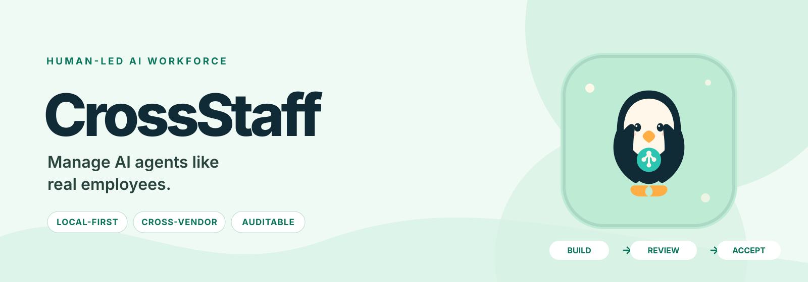
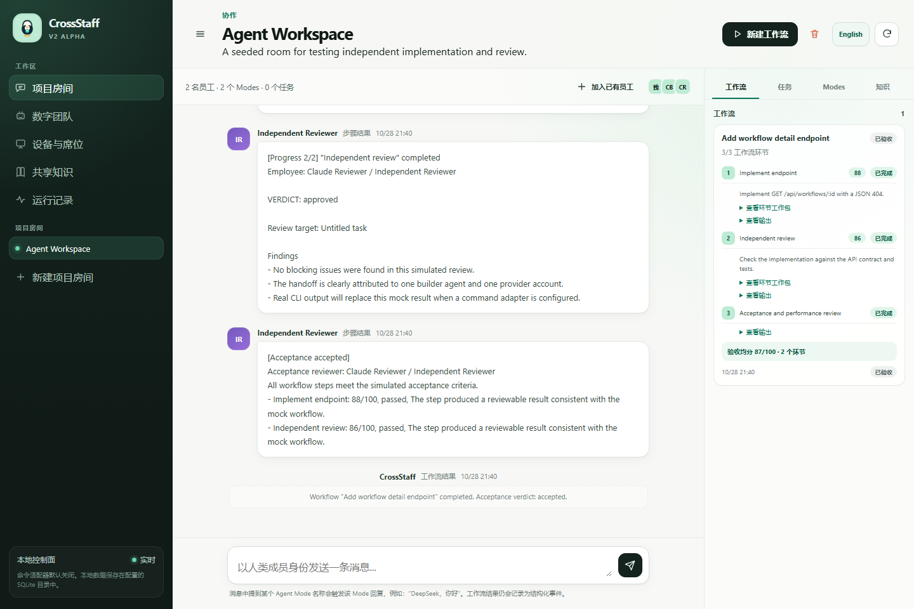
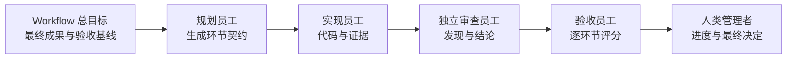

<p align="center">
  <picture>
    <source media="(prefers-color-scheme: dark)" srcset="docs/assets/crossstaff-banner-dark.svg">
    
  </picture>
</p>

<h1 align="center">本地优先的数字员工工作空间</h1>

<p align="center">
  <strong>像管理员工一样，管理你的 AI 团队。</strong>
</p>

<p align="center">
  <a href="docs/PLATFORMS.zh-CN.md"></a>
  
  
  <a href="docs/ARCHITECTURE.md"></a>
  
  <a href="LICENSE"></a>
  
</p>

<p align="center">
  <a href="README.md">English</a> ·
  <a href="README.zh-CN.md">简体中文</a> ·
  <a href="docs/QUICKSTART.zh-CN.md">快速开始</a> ·
  <a href="docs/API.md">API</a> ·
  <a href="docs/API-PROVIDERS.zh-CN.md">Provider</a> ·
  <a href="docs/ARCHITECTURE.md">架构</a> ·
  <a href="docs/BRAND.md">品牌</a>
</p>

CrossStaff 把一组分散的 AI Agent 变成一个可管理的数字员工团队。每名员工拥有稳定身份、一个有效组织/API/CLI 席位、私有记忆、多种角色行为和可审计历史。Room 提供共享项目知识与人类可见的协作空间；DAG 工作流负责员工之间的任务交接；独立验收员工逐环节评估结果。

CrossStaff 不是一个更大的 Agent 聊天窗口，而是围绕工作本身的管理层：谁负责、使用哪个账号、传递了什么上下文、谁进行了独立审查，以及最终凭什么验收。

<p align="center">
  
</p>

## 为什么需要 CrossStaff

大多数 Agent 产品优化一次 Prompt 或一次运行，但真实工作还需要回答组织问题：

- 哪个员工和账号对此负责？
- 它获得了哪些私有记忆与共享事实？
- 哪些环节可以并行，哪些必须等待？
- 这个环节必须交付什么，禁止做什么？
- 是否由另一名员工进行了独立审查？
- 最终验收分数依据了哪些证据？

CrossStaff 在执行前把这些边界显式化，并在执行后保留完整记录。

| 没有 CrossStaff | 使用 CrossStaff |
| --- | --- |
| 在多个终端之间复制上下文 | Room 共享知识 + 员工私有记忆 |
| 同一个 Agent 自写自审 | 不同员工之间的独立审查 |
| 只有一次性的 Prompt | DAG 中每个环节拥有明确工作包 |
| 手工记忆账号使用情况 | 一个有效席位对应一名数字员工 |
| 结果散落在聊天记录中 | 可审计运行、结论、评分和证据 |
| 绑定单一模型厂商 | 同时使用 Codex、Claude Code、Kimi Code 与兼容 API |

## 一条工作流，从目标到验收



每个工作环节都保存：

- **环节目标**：这名员工必须完成的局部成果。
- **输入要求**：需要的前置输出、文件、环境或确认。
- **必须交付**：代码、测试、审查发现或明确结论等可检查产物。
- **禁止事项**：范围边界和不得执行的操作。
- **完成标准**：本环节及验收者如何判断工作完成。

Workflow 总目标始终是更高层契约。环节目标只能缩小责任范围，不能静默删除全局要求。直接前置环节会把自己的目标、预期交付物和实际输出传给下游。

## 已包含能力

| 领域 | 能力 |
| --- | --- |
| **数字员工** | 花名册、经理关系、解雇、受限删除、员工记忆、绩效历史 |
| **席位与身份** | 每名员工仅有一个有效组织席位、API 主体或官方 CLI 账号 |
| **Agent Mode** | 同一员工可以承担多个角色，但不增加 Headcount |
| **Room** | 员工跨项目复用、共享知识、实时消息、安全删除 |
| **工作流** | 并行 Root、依赖汇合、环节契约、失败隔离、取消和实时进度 |
| **验收** | 自动最终验收、逐环节评分、证据和员工绩效聚合 |
| **Adapter** | 本地 Command、OpenAI-compatible API 和零依赖 Mock |
| **平台** | Windows、macOS、Linux 直接运行 Node；Docker 支持 UI 与 API/Mock |
| **界面** | 中英文切换、首次配置向导、SSE 实时更新 |

## 快速开始

**要求 Node.js 24 或更高版本。** 当前没有第三方运行时依赖。

```bash
git clone <repository-url>
cd <repository-directory>
npm start
```

打开 <http://localhost:8787>，完成首次配置向导。

启用本地 CLI：

```bash
CROSSSTAFF_ALLOW_COMMANDS=1 npm start
```

Windows PowerShell：

```powershell
$env:CROSSSTAFF_ALLOW_COMMANDS = "1"
npm start
```

完整的真实模型 Quick Start：

- [中文快速开始](docs/QUICKSTART.zh-CN.md)
- [English Quick Start](docs/QUICKSTART.md)

## 连接真实 Agent

### OpenAI 官方 API

把 Key 放在 `.env` 或 CrossStaff 进程环境中；AgentMode 只保存环境变量名称，不保存密钥。

```dotenv
OPENAI_API_KEY=your-openai-api-key
```

```json
{
  "type": "api",
  "provider": "openai",
  "baseUrl": "https://api.openai.com/v1",
  "model": "gpt-6.1-sol",
  "apiKeyEnv": "OPENAI_API_KEY",
  "timeoutMs": 180000
}
```

OpenAI 官方建议新项目优先使用 Responses；CrossStaff 当前为了跨 Provider 兼容使用 Chat Completions。请在[官方 API 模型目录](https://developers.openai.com/api/docs/models)确认账号可用的模型。

### DeepSeek

```dotenv
DEEPSEEK_API_KEY=your-deepseek-api-key
```

```json
{
  "type": "api",
  "provider": "deepseek",
  "baseUrl": "https://api.deepseek.com",
  "model": "deepseek-flash",
  "apiKeyEnv": "DEEPSEEK_API_KEY",
  "timeoutMs": 180000
}
```

### Kimi / Moonshot 与其他兼容 API

```dotenv
MOONSHOT_API_KEY=your-moonshot-api-key
```

```json
{
  "type": "api",
  "provider": "openai-compatible",
  "baseUrl": "https://api.moonshot.cn/v1",
  "model": "your-kimi-model",
  "apiKeyEnv": "MOONSHOT_API_KEY",
  "timeoutMs": 300000
}
```

任何满足 Bearer `POST /chat/completions` 且返回 `choices[0].message.content` 的服务都可以使用同一 Adapter：

| Provider | Base URL | 示例模型 |
| --- | --- | --- |
| OpenRouter | `https://openrouter.ai/api/v1` | 准确的 `provider/model-id` |
| Ollama | `http://127.0.0.1:11434/v1` | `ollama list` 中的模型名 |
| 其他兼容服务 | Provider Base URL | Provider 模型 ID |

当前 API Adapter 要求 Key 环境变量非空，因此 Ollama 可以设置 `OLLAMA_API_KEY=ollama` 作为本地占位值。

### 非 OpenAI 原生协议

当前直连 API Adapter **不支持** Anthropic Messages、Gemini `generateContent` 和 Azure OpenAI 的 deployment/Header 差异。请使用可信的本地 Command Adapter Bridge，或前置一个 OpenAI-compatible Gateway。详细指南包含 Anthropic 最小 Bridge 示例和协议差异：

→ **[API Provider 指南](docs/API-PROVIDERS.zh-CN.md)**

### Codex CLI

使用独立 `CODEX_HOME`，避免修改 Codex 桌面应用配置：

```powershell
# Windows
.\scripts\login-codex-cli.ps1
```

```bash
# macOS / Linux
./scripts/login-codex-cli.sh
```

### Claude Code 与 Kimi Code

Command Adapter 通过 stdin 传入完整 Prompt，读取 stdout，并执行超时与输出限制，不把 Prompt 拼接进 shell。详见 [Adapter 示例](docs/ADAPTERS.md)。

## 核心对象

| 对象 | 职责 |
| --- | --- |
| **Employee** | 稳定身份、岗位、经理、记忆、绩效和历史 |
| **SeatBinding** | 员工拥有的一个有效账号/API/CLI 授权 |
| **AgentMode** | 员工承担的一种角色行为 |
| **Room** | 共享消息、Mode、工作流上下文与知识的项目团队 |
| **Workflow Step** | 包含目标、输入、交付物、禁止事项和完成标准的工作包 |
| **Acceptance** | 另一名员工根据总目标和每个环节契约进行评估 |

独立审查必须来自 **不同员工**，不能只是同一员工的两个 Mode。

## 安全边界

> [!WARNING]
> CrossStaff 仍处于早期 Alpha，尚未提供身份认证、租户隔离或生产级远程 Connector。请保持 localhost 绑定。

- Command Adapter 默认禁用，必须在启动时设置 `CROSSSTAFF_ALLOW_COMMANDS=1`。
- Command Adapter 不是操作系统沙箱，本地程序继承 CrossStaff 进程权限。
- API 拒绝通过实体字段提交密码、Cookie、API Key 或 Session Token。
- 使用 `CODEX_HOME` 和 `CLAUDE_CONFIG_DIR` 隔离 CLI 配置。
- Docker 默认看不到宿主 CLI；本地代码 Agent 建议直接运行 Node。

连接敏感仓库或增加用户前，请阅读 [SECURITY.md](SECURITY.md) 和 [跨平台指南](docs/PLATFORMS.zh-CN.md)。

## 文档

| 目标 | 入口 |
| --- | --- |
| 跑通第一条真实工作流 | [中文](docs/QUICKSTART.zh-CN.md) · [English](docs/QUICKSTART.md) |
| 配置 Codex、Claude、Kimi 或 API | [Adapter 配置](docs/ADAPTERS.md) |
| 配置 OpenAI、DeepSeek、Kimi、OpenRouter、Ollama 或原生 API | [API Provider 指南](docs/API-PROVIDERS.zh-CN.md) |
| 自动化员工、Room 和工作流 | [HTTP API](docs/API.md) |
| 理解责任与信任边界 | [架构](docs/ARCHITECTURE.md) |
| 在 Windows/macOS/Linux 安装 | [跨平台指南](docs/PLATFORMS.zh-CN.md) |
| 查看公开产品说明 | [产品说明](docs/PRODUCT.md) |
| 正确使用企鹅品牌 | [品牌指南](docs/BRAND.md) |

## 开发

```bash
npm run check
npm test
```

CI 会在 Ubuntu、macOS 和 Windows 上使用 Node.js 24 运行测试。当前测试覆盖 Adapter、Room 隔离、员工生命周期、并行 Root、依赖阻塞、环节契约、独立验收、绩效评分和数据库迁移。

平台和 Docker 限制见 [跨平台指南](docs/PLATFORMS.zh-CN.md)。

## 项目状态

CrossStaff 当前面向已经同时使用多个 Agent 的开发者、小型研发团队和设计伙伴。近期重点是可靠的跨厂商实现与审查、显式环节契约和可核验验收。

后续计划：

- 带人工审核的 AI 工作流自动拆解
- 包含 diff、测试、工具调用和哈希的结构化交接产物
- 面向多电脑的出站 mTLS Connector
- 身份认证、工作区隔离、RBAC 和加密凭证库
- Git-backed 知识提案与审批

完整方向见 [ROADMAP.md](docs/ROADMAP.md)。

## 贡献

欢迎 Bug 报告、Adapter 实验、安全分析、文档和工作流测试。提交 PR 前请阅读 [CONTRIBUTING.md](CONTRIBUTING.md)；安全问题请按 [SECURITY.md](SECURITY.md) 私下报告。

## License

MIT，详见 [LICENSE](LICENSE)。

<p align="center">
  <strong>一个工作空间，多位 Agent，一支真正的团队。</strong>
</p>
