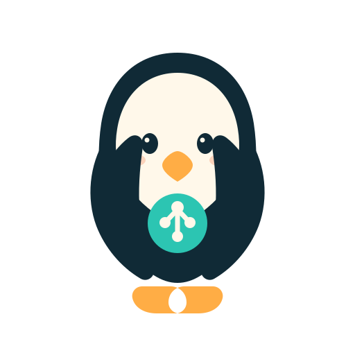

# CrossStaff Brand Guide

  
  

## Idea

A penguin crossstaff is a group of individuals sharing warmth while remaining distinct. CrossStaff applies that image to digital employees: each agent keeps its own identity, memory, account, and accountability, but works inside a shared room with common context.

The penguin holds a connected knowledge node with both flippers. The gesture communicates collaboration, ownership, and shared knowledge without turning the mark into a generic chat bubble or network icon.

## Assets

| Asset | Path | Use |
| --- | --- | --- |
| Primary mark | `public/assets/crossstaff-mark.svg` | Documentation, presentations, merchandise, and light or dark solid backgrounds |
| App icon | `public/assets/crossstaff-app-icon.svg` | Sidebar, onboarding, and scalable favicon |
| Raster icons | `public/assets/crossstaff-app-icon-{180,192,512}.png` | Apple touch icon and installable web app |
| README banners | `docs/assets/crossstaff-banner-{light,dark}.svg` | GitHub light and dark mode header artwork |
| Product screenshots | `docs/assets/crossstaff-demo.png`, `docs/assets/crossstaff-demo.zh-CN.png` | English and Chinese GitHub README previews |
| Manifest | `public/site.webmanifest` | Browser installation metadata |

## Palette

| Token | Value | Meaning |
| --- | --- | --- |
| Deep ink | `#102A36` | Penguin body, primary type, and control surfaces |
| Glacier mint | `#BDEBD4` | App icon field and collaboration |
| Signal teal | `#2CC5B2` | Shared knowledge and live state |
| Warm cream | `#FFF8EA` | Employee identity and readable negative space |
| Beak orange | `#FFAD45` | Warmth, action, and human character |

## Usage

- Keep clear space around the penguin equal to at least one-quarter of the icon width.
- Use the app icon when the background is busy or when the mark appears below 64px.
- Use the transparent mark on calm solid backgrounds with sufficient contrast.
- Pair the symbol with the exact wordmark `CrossStaff`; do not redraw, stretch, rotate, or add text inside the penguin.
- Do not replace the shared knowledge node with provider logos or credentials.

## Voice

Brand slogan:

> Manage AI agents like real employees.

中文 Slogan：

> 像管理员工一样，管理你的 AI 团队。

English descriptor:

> A local-first workspace for managing, collaborating with, and evaluating digital employees.

Chinese descriptor:

> 一个用于管理、协作与评估数字员工的本地优先工作空间。

The voice is calm, warm, and accountable. CrossStaff is a workplace metaphor, not a claim that agents are human.
